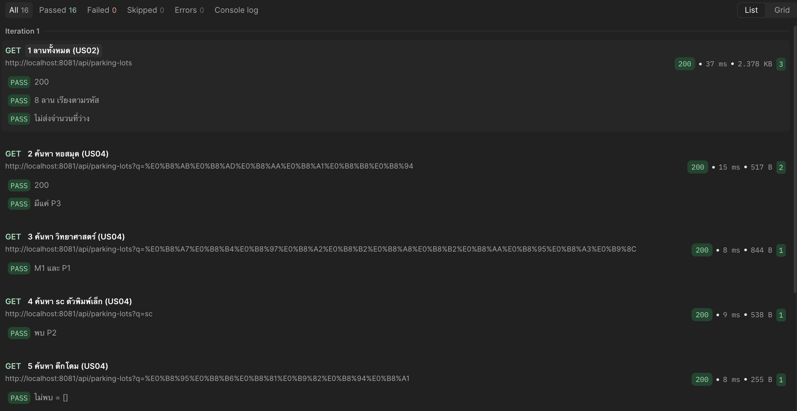
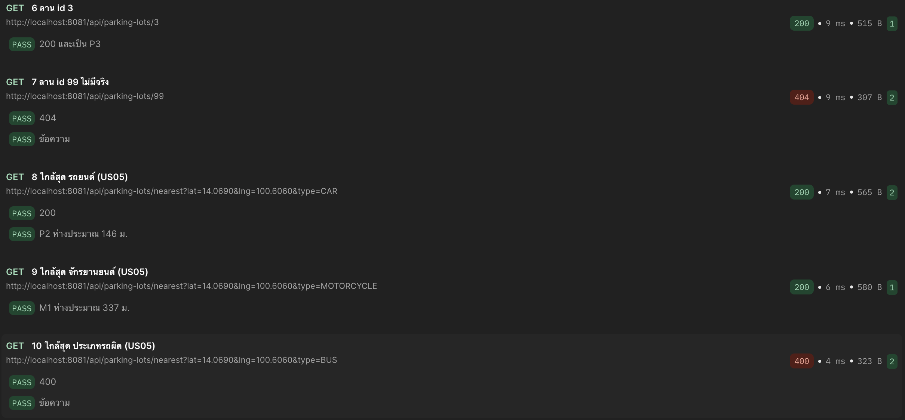

# ผลทดสอบ API Unit Test - Service + Controller

| | |
|---|---|
| ผู้รับผิดชอบ | ภาณุพงศ์ |
| test spec | `backend/src/test/java/th/ac/tu/smartparking/service/ParkingLotServiceTest.java`, `controller/ParkingLotControllerTest.java` |
| วันที่ทดสอบ | อ. 20 ต.ค. 2569 |
| สภาพแวดล้อม | Windows 11, Docker Desktop 29.3, Chrome (Chromium 147), ระบบรันด้วย `docker compose up -d --build` จาก `develop` (`342eae4`) + PR แก้ไขช่วงเช้า (เวลาไทย/README, CORS + ข้อความ 400, ค้นหา % _, aria-label, favicon) |
| วิธีทดสอบ | JUnit + Mockito (ไม่ต่อฐานข้อมูล), `cd backend` → `./mvnw test -Dtest=ParkingLotServiceTest,ParkingLotControllerTest` |

| รหัส | US | ทดสอบ | test method | ผลจริง | ผล |
|---|---|---|---|---|---|
| API-1 | US02 | ไม่ส่งคำค้น → ได้ทุกลาน | `ParkingLotServiceTest.noKeywordReturnsEveryLot()` | ผ่าน (0.001 s) | ผ่าน |
| API-2 | US02 | คำค้นเป็นช่องว่าง → ได้ทุกลาน | `ParkingLotServiceTest.blankKeywordAlsoReturnsEveryLot()` | ผ่าน (0.026 s) | ผ่าน |
| API-3 | US04 | ตัดช่องว่างหน้า-หลังคำค้นก่อนค้น | `ParkingLotServiceTest.searchUsesKeywordWithoutSpaces()` | ผ่าน (0.004 s) | ผ่าน |
| API-4 | US05 | เลือกลานที่ใกล้ที่สุด | `ParkingLotServiceTest.nearestPicksClosestLot()` | ผ่าน (0.0 s) | ผ่าน |
| API-5 | US05 | ใช้เฉพาะลานของประเภทรถที่เลือก | `ParkingLotServiceTest.nearestUsesOnlyLotsOfTheChosenVehicleType()` | ผ่าน (0.007 s) | ผ่าน |
| API-6 | US05 | ไม่มีลาน → "ยังไม่มีข้อมูลลานจอด" | `ParkingLotServiceTest.nearestThrowsWhenNoLotOfThatType()` | ผ่าน (0.001 s) | ผ่าน |
| API-7 | US05 | ประเภทรถผิด → error | `ParkingLotServiceTest.nearestRejectsUnknownVehicleType()` | ผ่าน (0.001 s) | ผ่าน |
| API-8 | - | id ไม่มีจริง → ไม่พบลานจอด | `ParkingLotServiceTest.findByIdThrowsWhenLotDoesNotExist()` | ผ่าน (0.003 s) | ผ่าน |
| API-9 | US05 | `/nearest` ตอบ 200 + ลาน + ระยะ | `ParkingLotControllerTest.nearestCarReturnsLotAndDistance()` | ผ่าน (0.036 s) | ผ่าน |
| API-10 | US05 | ประเภทรถผิด → 400 ข้อความไทย | `ParkingLotControllerTest.wrongVehicleTypeIs400()` | ผ่าน (0.017 s) | ผ่าน |
| API-11 | US05 | ไม่ส่ง lat → 400 "ต้องระบุ lat" | `ParkingLotControllerTest.missingLatitudeIs400InThai()` | ผ่าน (0.009 s) | ผ่าน |
| API-12 | US05 | lat ไม่ใช่ตัวเลข → 400 "ค่า lat ไม่ถูกต้อง" | `ParkingLotControllerTest.latitudeNotNumberIs400InThai()` | ผ่าน (0.045 s) | ผ่าน |
| API-13 | - | id ไม่มีจริง → 404 | `ParkingLotControllerTest.unknownLotIs404()` | ผ่าน (1.093 s) | ผ่าน |
| API-14 | ทุก US | CORS รับหน้าเว็บที่เปิดจาก 127.0.0.1:3000 | `ParkingLotControllerTest.allowsPageOpenedFrom127001()` | ผ่าน (0.036 s) | ผ่าน |

**สรุป: ผ่าน 14/14**

## หลักฐาน (Maven Surefire)

```text
-------------------------------------------------------------------------------
Test set: th.ac.tu.smartparking.service.ParkingLotServiceTest
-------------------------------------------------------------------------------
Tests run: 8, Failures: 0, Errors: 0, Skipped: 0, Time elapsed: 0.316 s -- in th.ac.tu.smartparking.service.ParkingLotServiceTest
-------------------------------------------------------------------------------
Test set: th.ac.tu.smartparking.controller.ParkingLotControllerTest
-------------------------------------------------------------------------------
Tests run: 6, Failures: 0, Errors: 0, Skipped: 0, Time elapsed: 7.062 s -- in th.ac.tu.smartparking.controller.ParkingLotControllerTest
```

## Postman รอบแรก (19 ต.ค. 23:10, ก่อนแก้พิกัดลานจริงใน PR #20)

ตอนนั้นตำแหน่งทดสอบยังเป็น 14.0690, 100.6060 (จักรยานยนต์ได้ M1), รอบปัจจุบันดู [integration-api-dao.md](integration-api-dao.md)



